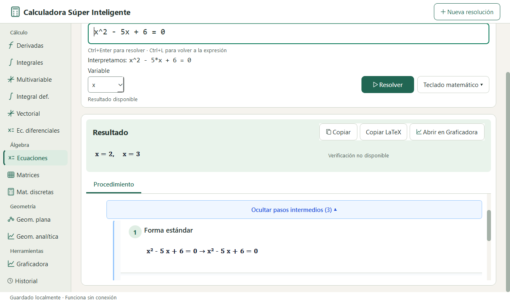
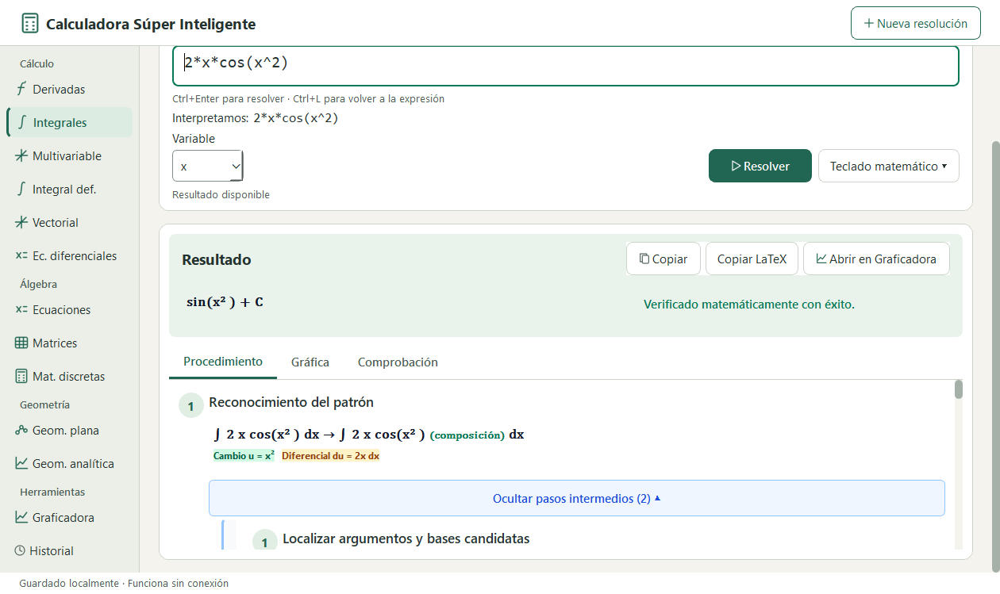
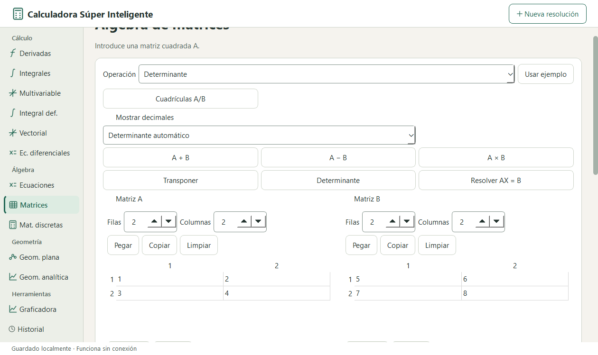
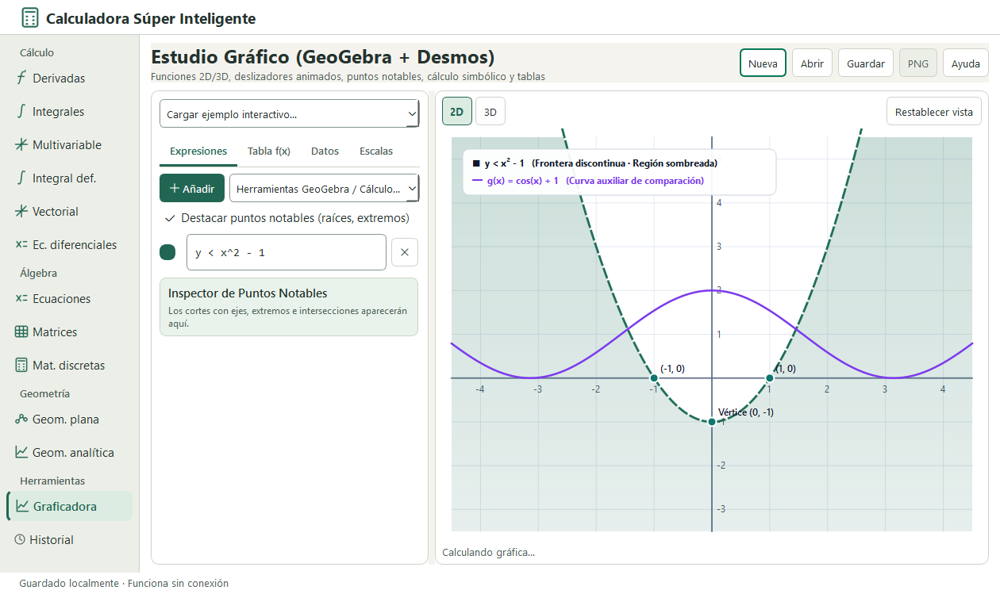

# 🧮 Calculadora Súper Inteligente


-F59E0B)


> [!WARNING]
> **🚧 Proyecto actualmente en desarrollo activo (Work in Progress / Beta)**
>
> Este proyecto se encuentra en **construcción y evolución continua**. Nuevos módulos matemáticos, desgloses pedagógicos paso a paso, mejoras del espacio de graficado 2D/3D y optimizaciones de interfaz se integran de forma iterativa. Algunas funciones avanzadas pueden cambiar o ampliarse en próximas versiones.

**Calculadora Súper Inteligente** es una aplicación educativa de escritorio en español para Windows construida con **Python**, **PySide6 (Qt 6)**, **SymPy**, **Lark** y **NumPy**. Combina resolución simbólica exacta, **procedimiento pedagógico paso a paso con subpasos desplegables**, **editor matricial interactivo $A/B$**, **cálculo multivariable/vectorial** y un **espacio de graficado 2D/3D e inecuaciones** 100 % local y sin necesidad de conexión a internet ni suscripciones.

---

## 📸 Capturas de pantalla (Estado actual en ejecución)

### 1. Resolución algebraica con árbol de subpasos desplegables y fórmulas KaTeX
Desglose paso a paso para ecuaciones lineales y cuadráticas (forma estándar $P(x)=0$, identificación de coeficientes, cálculo del discriminante $\Delta = b^2 - 4ac$ y fórmula general) con tarjetas expandibles:



### 2. Cálculo de integrales y derivadas paso a paso
Motor simbólico con explicación de reglas aplicadas (regla de la cadena, integración por sustitución con resaltado semántico de cambio de variable $u$ y diferencial $du$, integración por partes y verificación simbólica automática):



### 3. Editor matricial interactivo $A \leftrightarrow B$ (estilo MatrixCalc)
Cuadrículas dinámicas para las matrices $A$ y $B$, inserción de ejemplos, intercambio $A \leftrightarrow B$, determinante, inversa, rango, transpuesta, potencia, eliminación de Gauss/Gauss-Jordan, valores/vectores propios y sistemas lineales $Ax = b$:



### 4. Graficadora interactiva 2D / 3D y regiones de inecuaciones
Espacio dedicado de graficado con soporte para múltiples expresiones simultáneas, deslizadores de parámetros, derivadas/integrales visuales, puntos notables (raíces, extremos, intersecciones), superficies 3D y **sombreado de inecuaciones** con distinción explícita entre frontera discontinua ($<, >$) y frontera continua ($\le, \ge$):



---

## ✨ Características principales

- **Cálculo Diferencial e Integral**:
  - Derivadas de orden arbitrario con desglose de reglas (potencia, producto, cociente, cadena).
  - Integrales indefinidas y definidas con explicación de sustitución ($u$ / $du$) y verificación por derivación simbólica.
- **Álgebra y Ecuaciones**:
  - Resolución simbólica de ecuaciones polinómicas y trascendentes con árbol de pasos intermedios desplegables (`Mostrar/Ocultar pasos intermedios`).
- **Álgebra Lineal y Matrices**:
  - Cuadrículas interactivas $A$ y $B$ con preservación de estado, operaciones directas ($A+B$, $A-B$, $A \cdot B$, $\det(A)$, $A^{-1}$, $\text{rango}(A)$, RREF, LU, QR, diagonalización y sistemas lineales).
- **Cálculo Multivariable y Vectorial**:
  - Derivadas parciales, vector gradiente $\nabla f$, laplaciano $\nabla^2 f$, matriz hessiana, derivada direccional, divergencia y rotacional.
- **Ecuaciones Diferenciales (EDO), Matemática Discreta y Geometría**:
  - Módulos estructurados con catálogo de operaciones guiadas y botones de ejemplo inmediato.
- **Graficadora 2D / 3D y Coordenadas Polares / Paramétricas**:
  - Transferencia directa desde el solucionador (`Abrir en Graficadora`), sombreado de inecuaciones 2D, superficies $z = f(x,y)$ y exportación de imagen.
- **Arquitectura Segura y 100 % Local**:
  - Renderizado tipográfico matemático mediante **KaTeX local** servido por esquema aislado `math://` (sin CDN externo).
  - **Proceso de cálculo aislado (`CalculationProcessController`)** con límite de tiempo y botón de cancelación para evitar bloqueos de la interfaz ante integrales o sistemas pesados.
  - **Historial local en SQLite** con búsqueda y recarga de resoluciones anteriores.

---

## 🏗️ Arquitectura del proyecto

El proyecto sigue **Clean Architecture** con separación estricta de responsabilidades:

```text
calculadora/
├── src/
│   ├── main.py                        # Punto de entrada principal de la UI (PySide6)
│   ├── bootstrap.py                   # Inyección de dependencias, esquema math:// e historial SQLite
│   ├── domain/                        # Núcleo matemático, entidades, pasos educativos y módulos
│   │   ├── modules/                   # derivatives, integrals, equations, matrices, multivariable, etc.
│   │   ├── expressions/               # AST matemático y trazabilidad de spans
│   │   └── steps.py                   # Contratos de EducationalStep y StepOutcome
│   ├── application/                   # Casos de uso (SolveMathExpressionUseCase) y orquestación
│   ├── infrastructure/                # Parser Lark, adaptador SymPy, graficadora y persistencia SQLite
│   └── presentation/                  # Ventana principal PySide6, editor matricial, MathView y temas QSS
├── tests/
│   ├── unit/                          # Pruebas unitarias de dominio, aplicación, infraestructura y UI
│   └── integration/                   # Pruebas de integración del flujo completo y empaquetado
├── docs/                              # Especificaciones técnicas y capturas de pantalla
├── replica/                           # Inventario de paridad funcional, tokens de diseño WCAG AA y pruebas
├── CalculadoraSuperInteligente.spec   # Especificación de compilación a ejecutable (.exe) con PyInstaller
├── run.py                             # Lanzador compatible con PyInstaller y modo --self-test
└── pyproject.toml                     # Configuración de dependencias, Ruff, Mypy y Pytest
```

---

## 🚀 Requisitos e instalación desde código fuente

### Requisitos previos
- **Windows 10 / 11** (64 bits)
- **Python 3.13+** (recomendado gestionar con [`uv`](https://docs.astral.sh/uv/) o `venv`)

### 1. Clonar el repositorio y crear el entorno virtual

```powershell
git clone https://github.com/BlackWolfJM/Calculadora-.git
cd Calculadora-

# Opción A: Usando uv (recomendado)
uv sync

# Opción B: Usando venv estándar
python -m venv .venv
.\.venv\Scripts\pip install -e .
```

### 2. Ejecutar la aplicación

```powershell
& .\.venv\Scripts\python.exe .\src\main.py
```

---

## 📦 Compilar y ejecutar como archivo `.exe` (Standalone Windows)

El proyecto incluye soporte completo para compilarse en un ejecutable autónomo de Windows (`CalculadoraSuperInteligente.exe`) mediante **PyInstaller** usando el archivo [`CalculadoraSuperInteligente.spec`](CalculadoraSuperInteligente.spec):

### 1. Generar el ejecutable `.exe`

```powershell
& .\.venv\Scripts\python.exe -m PyInstaller CalculadoraSuperInteligente.spec --noconfirm
```

### 2. Verificar el ejecutable compilado (Self-Test automático)

```powershell
& .\dist\CalculadoraSuperInteligente\CalculadoraSuperInteligente.exe --self-test
# Salida esperada: SELF_TEST_OK (código de salida 0)
```

### 3. Abrir el ejecutable `.exe`

```powershell
& .\dist\CalculadoraSuperInteligente\CalculadoraSuperInteligente.exe
```

El ejecutable compilado queda en `dist\CalculadoraSuperInteligente\CalculadoraSuperInteligente.exe` junto con todas las librerías nativas de Qt6, SymPy, NumPy, la gramática Lark y los recursos locales de KaTeX, listo para ejecutarse sin requerir Python instalado.

---

## 🧪 Ejecutar pruebas y controles de calidad

```powershell
# Ejecutar la suite de pruebas automatizadas (Pytest)
& .\.venv\Scripts\python.exe -m pytest -q

# Verificar estilo y linter (Ruff)
& .\.venv\Scripts\python.exe -m ruff check src tests

# Verificar tipado estático (Mypy)
& .\.venv\Scripts\python.exe -m mypy src
```

---

## 📄 Licencia

Distribuido bajo la licencia especificada en [`LICENSE`](LICENSE).
